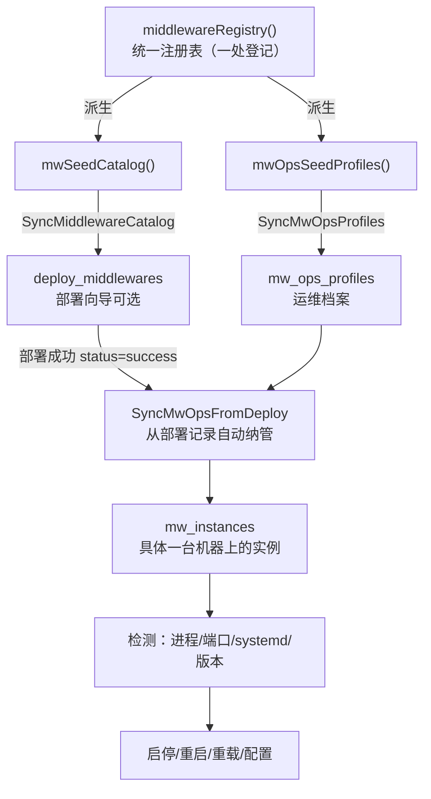

# 中间件添加手册（部署 + 运维一体化）

> 适用代码基线：`backend/model_deploy.go`、`backend/model_mwops.go`、`backend/handler_deploy.go`、`backend/handler_mwops.go`
> 目标：把"新增一种中间件"从"改两处、靠人工对齐"收敛为"**一处登记**"。

---

## 0. 这套机制解决什么问题

过去要在平台里接入一种新中间件，需要在两个地方分别登记，而且靠 `部署目录.Name == 运维档案.Type` 手工对齐：

| 维度 | 表 | 登记函数 | 风险 |
|---|---|---|---|
| 部署（装到机器上） | `deploy_middlewares` | `mwSeedCatalog()` | 漏登 → 部署向导看不到 |
| 运维（启停/进程/配置） | `mw_ops_profiles` | `mwOpsSeedProfiles()` | 漏登 → 部署后无法自动纳管，或手动纳管后检测不到 |

本项目已把两者合并为**统一注册表 `middlewareRegistry()`**（位于 `backend/model_deploy.go`）。
新增一种中间件 = 在注册表里加一条 `MiddlewareDef`，部署目录与运维档案由它**自动派生**，从源头消除漂移。

数据流：



---

## 1. 标准添加流程（5 步）

1. **登记**：在 `middlewareRegistry()` 增加一条 `MiddlewareDef`（见第 3 节字段说明）。
2. **备料**：在控制节点 `app_choice/<子目录>/` 下放好离线包 / 部署脚本 / playbook（见第 5 节）。
3. **启用**：设 `Ready:true, Enabled:true`；改完把 `mwSeedVer`（`model_deploy.go`）**+1**，让已有 DB 行刷新。
4. **重启后端**：`SyncMiddlewareCatalog()` 与 `SyncMwOpsProfiles()` 在启动时（`seed()`）幂等同步。
5. **验证**：部署一次 → 运维页「从部署同步」→ 检测 → 启停 → 配置编辑（见第 9 节清单）。

> 如果只是**新增一个已有中间件的版本**（例如再上一个 nginx 1.29），不需要新档案，只需在对应 `Packages` 里加一条离线包即可（见第 7 节示例 B）。

---

## 2. 注册表条目结构（`MiddlewareDef`）

`MiddlewareDef` 同时包含"部署侧"和"运维侧"全部字段。关键约束：

- `Name` 是唯一 key，**同时作为运维档案的 `Type`**（如 `nginx`、`redis`、`宝兰德bws310`）。两边靠它对齐，所以**绝对不要写错**。
- `IncludeOps`：为 `false` 时只在部署目录登记、不生成运维档案（当前仅 `mysql` 用，因为还没接入运维）。新增中间件一般设 `true`。

---

## 3. 字段详解

### 3.1 部署侧字段

| 字段 | 类型 | 说明 |
|---|---|---|
| `Name` | string | 唯一 key，也是运维 `Type`（必填）。建议用英文小写，如 `elasticsearch` |
| `Label` | string | 展示名，如 `Elasticsearch` |
| `Icon` | string | 前端图标 key（需 `MwBrandIcon` 里有对应映射，否则用默认色块） |
| `Category` | string | 分类：Web服务器 / 运行环境 / 应用服务器 / 数据库缓存 |
| `Description` | string | 部署向导里的说明 |
| `Enabled` | bool | 是否在部署向导可选 |
| `Versions` | `[]string` | 可选版本列表（展示用） |
| `Packages` | `map[string]PkgInfo` | **按"操作系统×CPU"维度的离线包矩阵**，key 形如 `centos7_x86_64`，支持 `any_` 通配 |
| `Modes` | `[]DeployModeDef` | 部署模式（单机/集群/哨兵），无需则留 `nil` |
| `SubDir` | string | 控制节点脚本子目录，默认等于 `Name` |
| `Style` | string | 部署执行方式：`copy` / `unarchive` / `dir` / `playbook`（见第 5 节） |
| `Playbook` | string | `Style=playbook` 时，控制节点上 playbook 的绝对路径 |
| `InstallPath` | string | 默认安装路径（**展示用**，部署以 `Packages.Target` 为准） |
| `DefaultPort` | string | 默认端口（展示 + 运维实例默认值） |
| `CertDir` | string | 证书下发目录（目标机绝对路径） |
| `NeedCert` | bool | 部署时是否需要证书（如 nginx SSL） |
| `Ready` | bool | 离线包是否已就位（控制节点路径存在） |

**`PkgInfo` 字段**：

| 字段 | 说明 |
|---|---|
| `Pkg` | 控制节点上离线安装包（`.tar.gz` 等）的**完整路径** |
| `Script` | 控制节点上部署脚本（`.sh`）的**完整路径**（`unarchive` 包内自带可留空；`playbook` 不用） |
| `Target` | 目标机安装路径，**会作为参数传给部署脚本**（仅 `copy` 风格传 `$1`，其余风格脚本自行固化路径） |
| `Zones` | 适用网络区域（如 `["互联网"]`），空 = 全部区域通用 |

**Packages key 匹配优先级**（在 `GetPkg()` 中）：`精确os_cpu` → `os_any` → `any_cpu` → `any_any`，每层再按 `Zones` 过滤。`any` 由常量 `WildcardAny` 表示。
示例（redis 只按 CPU 分发）：`any_x86_64`、`any_aarch64`；bws310 不区分平台：`any_any`。

### 3.2 运维侧字段

| 字段 | 说明 |
|---|---|
| `ProcessPattern` | `pgrep -f` 的匹配串（ERE）。建议足够具体，避免把承载命令的 shell 自己也匹配上 |
| `Units` | systemd 单元名候选（`[]string`，落库时逗号拼接）。**填了就优先走 `systemctl`，Cmd* 仅作无 systemd 回退** |
| `DefaultPaths` | 常见安装路径，检测时用于自动发现（实例 `InstallPath` 为空时） |
| `ConfigPaths` | 配置文件候选（`[]string`，支持 `{path}` 占位与尾部 `*` 通配，如 `{path}/conf/*.conf`） |
| `ConfigTestCmd` | 配置校验命令（如 `{sbin}/nginx -t`） |
| `VersionCmd` | 版本探测命令，输出回填实例版本号 |
| `CmdStart` / `CmdStop` / `CmdRestart` / `CmdReload` | 启停命令**模板**（占位符见第 4 节） |
| `ProcessOnly` | `true` 表示该类型没有"单体服务"概念，以进程为管理对象（如 `jdk` / java 应用） |
| `OpsDesc` | 运维档案里的说明 |
| `IncludeOps` | 是否生成运维档案（默认 `true`） |

---

## 4. 命令模板占位符

运维命令模板（以及 `ConfigPaths`、`ConfigTestCmd`、`VersionCmd`）支持以下占位符，执行时由平台按实例实际值渲染：

| 占位符 | 含义 |
|---|---|
| `{path}` | 安装路径（`InstallPath`，为空时用 `DefaultPaths` 自动发现回填） |
| `{sbin}` | = `{path}/sbin`（由 path 推导） |
| `{conf}` | 第一个命中的配置文件路径 |
| `{port}` | 端口 |
| `{pid}` | 当前主进程 PID |
| `{unit}` | systemd 单元名 |

> 渲染后的每个值都会用 `shq()` 包裹，避免路径/参数含空格或特殊字符时破坏命令。

---

## 5. 后台脚本怎么写（按 `Style`）

平台在控制节点生成一份 ansible playbook，把离线包/脚本上传到目标机 `/tmp` 后执行。四种风格的脚本契约如下：

### 5.1 `copy`（nginx / jdk）
- 平台动作：上传 `Pkg` + `Script` 到 `/tmp`，执行 **`bash /tmp/<script_name> <target>`**（`$1` = 安装目标路径）。
- 脚本要点：用 `$1` 作为安装目录；解压/拷贝；注册 systemd 服务；放行防火墙；写 `JAVA_HOME` 之类环境变量到 `/etc/profile.d`。
- 适合：自带安装脚本、安装路径可参数化的中间件。

### 5.2 `unarchive`（php）
- 平台动作：上传 `tar.gz` 并解压到 `/tmp`，执行 **`bash /tmp/<unpack>/<unpack>.sh`**（**不传 target 参数**）。
- 脚本要点：安装路径一般在脚本内固化（或读包内配置），因为平台不会把 target 传进来。
- 适合：包内自带同名安装脚本、自包含的中间件。

### 5.3 `dir`（宝兰德 BWS310）
- 平台动作：上传整个 `files` 目录到 `/tmp`，执行 **`bash /tmp/<script_name>`**（**不传 target 参数**）。
- 适合：脚本依赖同目录的配置文件/资源。

### 5.4 `playbook`（redis / 推荐用于 ES 这类标准服务）
- 平台动作：**直接执行控制节点上已有的 playbook**（platform 模式：写临时 inventory + `-i`；group 模式走 `ansible_host_manager`）。目标机由控制节点去连，你只写标准 ansible 逻辑即可。
- 适合：能写成 ansible playbook、希望复用既有运维脚本的中间件。**新增中间件首选**，因为不用关心上传/解压细节。

### 5.5 证书环境变量（仅 `NeedCert=true` 时注入）
部署脚本通过 ansible `environment:` 注入以下变量，脚本据此自行完成 SSL 配置：

| 变量 | 含义 |
|---|---|
| `HAS_CERT` | 本次是否下发证书（`true`/`false`） |
| `CERT_DIR` | 证书落地目录（= 档案 `CertDir`） |
| `CERT_NAME` | 证书名（域名/cn） |
| `CERT_CRT` | CRT 文件名 |
| `CERT_KEY` | KEY 文件名 |
| `CERT_CA` | CA 文件名（有 CA 时才下发） |

---

## 6. 实战示例 A：新增「单节点 Elasticsearch」

这是"从零新增一种中间件"的完整范例：部署 + 运维都要登记。

### 6.1 注册表条目（`middlewareRegistry()` 里加一条）

```go
{
    Name: "elasticsearch", Label: "Elasticsearch", Icon: "elasticsearch", Category: "数据库缓存",
    Description: "Elasticsearch 单节点（解压即用 + systemd 托管，端口 9200/9300）",
    Versions: []string{"8.13.4"},
    Packages: map[string]PkgInfo{
        WildcardAny + "_x86_64":   {Pkg: base + "/elasticsearch/files/elasticsearch-8.13.4-linux-x86_64.tar.gz", Target: "/data/elasticsearch"},
        WildcardAny + "_aarch64":  {Pkg: base + "/elasticsearch/files/elasticsearch-8.13.4-linux-aarch64.tar.gz", Target: "/data/elasticsearch"},
    },
    SubDir: "elasticsearch", Style: StylePlaybook,
    Playbook: base + "/elasticsearch/es-single.yml",
    InstallPath: "/data/elasticsearch", DefaultPort: "9200",
    NeedCert: false, Ready: true, Enabled: true, IncludeOps: true,
    // —— 运维侧 ——
    ProcessPattern: "org.elasticsearch.bootstrap.Elasticsearch",
    Units:          []string{"elasticsearch"},
    DefaultPaths:   []string{"/data/elasticsearch", "/usr/local/elasticsearch", "/opt/elasticsearch"},
    ConfigPaths:    []string{"{path}/config/elasticsearch.yml", "{path}/config/jvm.options"},
    VersionCmd:     "{path}/bin/elasticsearch -V 2>&1",
    // 填了 Units → 平台优先 systemctl；下面 Cmd* 仅作"无 systemd 时"的回退
    CmdStart:   "{sbin}/elasticsearch -d -p {path}/pidfile",
    CmdStop:    "kill -TERM $(cat {path}/pidfile 2>/dev/null) 2>/dev/null || true",
    CmdRestart: "kill -TERM $(cat {path}/pidfile 2>/dev/null) 2>/dev/null; sleep 2; {sbin}/elasticsearch -d -p {path}/pidfile",
    CmdReload:  "",
    OpsDesc:    "ES 主进程为 org.elasticsearch.bootstrap.Elasticsearch；优先用 systemd 单元管理",
},
```

`Icon: "elasticsearch"` 需要前端 `MwBrandIcon.tsx` 里有对应图标映射（否则显示默认色块）。如需新图标，参考 `components/MwBrandIcon.tsx` 的 `MW_BRAND_COLOR` 与图标表补一个。

### 6.2 控制节点文件（放到 `app_choice/elasticsearch/`）

```
app_choice/elasticsearch/
├── files/
│   ├── elasticsearch-8.13.4-linux-x86_64.tar.gz
│   └── elasticsearch-8.13.4-linux-aarch64.tar.gz
└── es-single.yml          # 标准 ansible playbook
```

`es-single.yml` 示例骨架（解压 → 建运行用户 → systemd → 调内核参数）：

```yaml
- name: 单节点 Elasticsearch 安装
  hosts: "{{ hosts }}"          # 由平台注入
  become: true
  vars:
    es_home: "/data/elasticsearch"
  tasks:
    - name: 解压安装包
      unarchive:
        src: "{{ es_pkg }}"     # 平台把离线包路径作为 extra var 传入
        dest: "/data/"
        remote_src: true
    - name: 创建运行用户
      user: { name: elasticsearch, system: true, shell: /sbin/nologin }
    - name: 写 systemd 单元
      template:
        src: elasticsearch.service.j2
        dest: /etc/systemd/system/elasticsearch.service
    - name: 重载并启动
      systemd: { name: elasticsearch, daemon_reload: true, enabled: true, state: started }
```

> 平台执行 `playbook` 风格时会以 platform/group 模式注入 hosts 与 inventory，你**只需写服务安装逻辑**，不用管目标机连接。

### 6.3 验证
1. 重启后端（`mwSeedVer` 已 +1）。
2. 部署向导 → 选 ES → 部署一次（成功）。
3. 运维页 → 中间件管控 → 「从部署同步」→ ES 实例自动出现。
4. 点「检测」确认 running；试「重启」「配置」编辑 `elasticsearch.yml`。

---

## 7. 实战示例 B：新增一个 nginx 的其他版本

**版本差异只体现在 `Packages` 矩阵，运维档案按 `Type` 共享，所以"换版本"几乎零成本。**

在 `middlewareRegistry()` 的 nginx 条目里，给 `nginxPkgs` 增加一条即可（运维侧完全不动）：

```go
// 在 nginxPkgs 构造循环/字面量里补充：
nginxPkgs["openEuler22.03_x86_64"] = PkgInfo{
    Pkg:    base + "/nginx/files/nginx-1.29.0-openEuler22.03-x86_64.tar.gz",
    Script: base + "/nginx/files/deploy-nginx-1.29.0-openEuler22.03-x86_64.sh",
    Target: "/data/nginx",
}
// 同时把版本号也加进 Versions：Versions: []string{"1.28.3", "1.29.0"}
```

控制节点对应放好 `nginx-1.29.0-*.tar.gz` 与 `deploy-nginx-1.29.0-*.sh` 即可。运维档案（`ProcessPattern="nginx: master"`、`Cmd*`、`ConfigPaths`）对 1.29 完全复用。

> 如果新版本的安装布局/配置文件差异大到需要**独立的运维口径**（比如配置目录变了），再新建一个 `Name: "nginx129"` 的条目，复用 `ProcessPattern: "nginx: master"`，单独写 `ConfigPaths`/`Cmd*`，而不是硬塞进原 nginx。

---

## 8. 运维侧常见坑（务必看）

- **`ProcessPattern` 自匹配陷阱**：平台把远端命令包在 `sh -c "<整段脚本>"` 里执行，脚本正文若含匹配串（如 `nginx: master`），`pgrep -f` 会把承载 shell 也算进进程 → **永远显示 running**。规避：用更具体的串（ES 用 `org.elasticsearch.bootstrap.Elasticsearch` 而非 `java`）；或在实例上填 `Units` 走 systemd 判定。
- **php 别用 `pkill`**：同样会因 `sh -c` 自匹配误杀。平台 php 档案已改为按 **pid 文件** 精确操作（`kill -QUIT $(cat .../php-fpm.pid)`）。
- **配置写入安全**：平台只允许写"命中 `ConfigPaths` 候选（含通配）"的路径，防越权写任意文件；写前自动 `*.ophub.bak` 备份，支持回滚。
- **改完注册表记得 `mwSeedVer` +1**：否则已存在的 DB 行（`seed_ver` 已等于旧值）不会被刷新，你加的字段不生效（从未登记包 / 为空的行仍会刷新）。运维档案同步用同一版本号（`mwOpsSeedVer = mwSeedVer`），不用再单独改。
- **`Name` 别写错**：它同时是运维 `Type`。如果部署用 `elasticsearch`、运维却拼成了 `es`，`SyncMwOpsFromDeploy` 会因 `mwOpsProfileFor("es")` 找不到档案而跳过纳管。

---

## 9. 验证清单（提交前过一遍）

- [ ] `go build ./... && go vet ./...` 通过（`gofmt -l` 零漂移）
- [ ] 前端 `node_modules/typescript/bin/tsc -b` 零错误（若动了图标/类型）
- [ ] 部署向导能看到新中间件并可成功部署
- [ ] `GET /api/mwops/profiles` 返回新类型，且 `instanceCount` 正确
- [ ] 手动纳管 / 从部署同步后，实例「检测」能正确判定 running / stopped（**未安装不应误报 running**）
- [ ] 启停 / 重启 / 重载（systemd 与模板两条路径都试）
- [ ] 配置列表 / 读取 / 保存校验 / 回滚可用
- [ ] 越权路径被拒绝（写非 `ConfigPaths` 命中路径应失败）
- [ ] 可扩展 `.workbuddy/e2e-ansible/verify_mwops.py` 覆盖新中间件

---

## 10. 改动涉及的文件速查

| 文件 | 作用 |
|---|---|
| `backend/model_deploy.go` | `MiddlewareDef` 结构 + `middlewareRegistry()`（**唯一登记处**）+ `mwSeedCatalog()` 派生 + `mwSeedVer` |
| `backend/model_mwops.go` | `mwOpsSeedProfiles()` 由注册表派生、`MwOpsProfile`/`MwInstance` 结构、`mwOpsSeedVer` |
| `backend/handler_deploy.go` | 部署执行（4 种 Style 的脚本调用契约、证书注入） |
| `backend/handler_mwops.go` | 运维：检测/启停/配置/从部署同步 |
| `backend/db.go` | `AutoMigrate` 两张表 + `seed()` 里调用两个 `Sync*()` |
| `frontend/src/components/MwBrandIcon.tsx` | 新增 `Icon` 时需补图标/配色 |
| `D:/.../app_choice/<子目录>/` | 控制节点离线包 / 脚本 / playbook（文件侧） |
